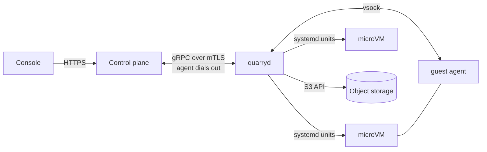
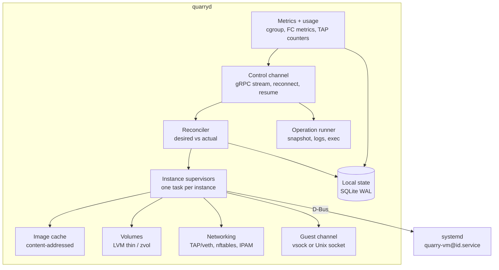
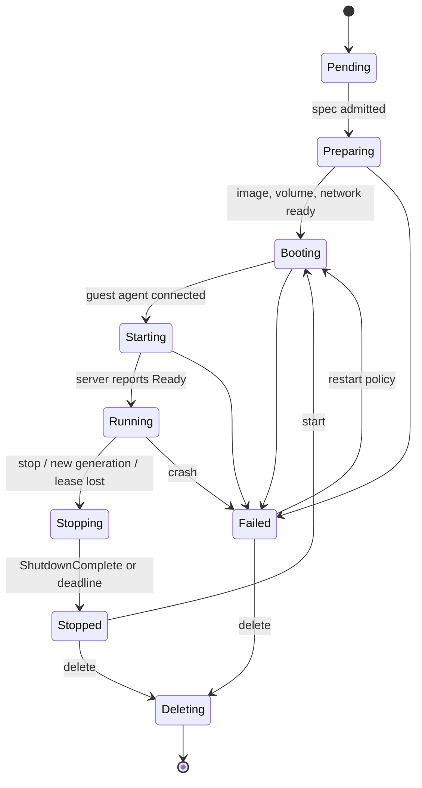
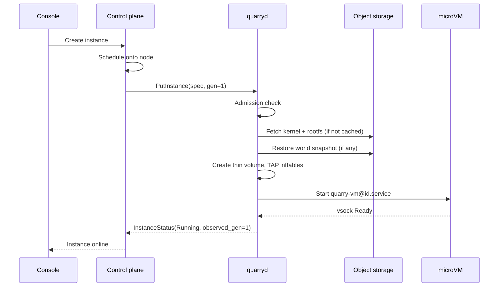

# quarryd — Node Agent Design

Status: draft
Scope: the daemon that runs on every compute host and provisions, supervises, and reports on microVM server instances on behalf of the central control plane.

---

## 1. Terminology and boundaries

| Term | Meaning |
|---|---|
| **Console** | Customer/operator web UI. Talks only to the control plane. |
| **Control plane** | Central Rust service. Owns scheduling, desired state, billing, auth. |
| **quarryd** (node agent) | This document. One per host. Converges the host to the desired state it is given and reports actual state. |
| **Instance** | One microVM running one Minecraft server or one runtime shard. |
| **Guest agent** | Small process inside the microVM that talks to quarryd over vsock. |

quarryd **does**:
- Create, start, stop, snapshot, and destroy microVMs.
- Manage per-instance disks, networking, and images on the host.
- Report health, status, metrics, logs, and raw usage counters.
- Keep instances running when the control plane is unreachable.

quarryd **does not**:
- Decide placement (the control plane schedules; quarryd only admits or rejects).
- Compute prices or invoices (it ships raw usage; billing happens centrally).
- Accept inbound connections from the internet or from the console.



---

## 2. Host assumptions

- Linux, kernel 6.1+, cgroup v2.
- `/dev/kvm` is **optional**. When present, instances run as Firecracker microVMs. When absent, instances run under gVisor (`runsc`, systrap platform). quarryd detects this at startup and reports it in `Hello.capabilities`; the control plane only places an instance on a node whose capabilities satisfy the instance's `isolation` field.
- KVM sources: bare-metal or dedicated servers, or cloud VM types with nested virtualization (AWS C7i/M7i/R7i, 8th-gen Intel families, GCP, Azure).
- Local NVMe for instance volumes.
- systemd as PID 1.
- Dedicated public IPv4 networking requires `conntrack` from conntrack-tools on the host's `PATH` (`apt install conntrack` on Debian/Ubuntu), in addition to `nft` and `tc`. Public address changes remain blocked if connection cleanup cannot run.
- x86_64 first; aarch64 is supported by the VMM but is a second build target.

---

## 3. Sandbox backends

Instances run behind a `Sandbox` trait with two backends:

- **Firecracker** with its **jailer** — used when KVM is available. Strongest isolation.
- **gVisor** (`runsc`, systrap platform, OCI bundle) — used when KVM is not available.

Cloud Hypervisor is listed for comparison and may be added later as a third backend.

| | Firecracker | Cloud Hypervisor |
|---|---|---|
| Boot time | ~125 ms to guest init | Slightly slower, still sub-second |
| Devices | virtio-net, virtio-block, vsock, balloon | Adds virtio-fs, PCI, hotplug |
| CPU hotplug | No | Yes |
| Memory resize | Balloon only | Hotplug + balloon |
| Snapshots | Yes (full + diff) | Yes |
| Isolation tooling | Jailer (chroot, seccomp, uid, netns, cgroups) | Seccomp, landlock; jailing is on you |

Firecracker is enough for v1: Minecraft instances get a fixed vCPU count, and memory can be adjusted with the balloon. Plan sizes are changed by restart, which is acceptable because the runtime handles player continuity at the shard level.

gVisor differences that the rest of the design must account for:
- No kernel/rootfs pair: the image is an OCI rootfs (same squashfs artifact, mounted read-only as the bundle root) and the instance data volume is bind-mounted.
- No vsock: the guest channel uses a Unix socket bind-mounted into the sandbox (section 4.8).
- No balloon: memory limits are cgroup `memory.max` only; `set_memory_target` returns `Unsupported`.
- Snapshots of running memory are not used. World backups use the volume snapshot path (section 4.6), which works the same for both backends.
- Networking: the sandbox gets its own network namespace with a veth pair instead of a TAP device; addressing and nftables rules are identical.

```rust
#[async_trait]
pub trait Sandbox: Send + Sync
{
    fn kind(&self) -> SandboxKind; // Firecracker | Gvisor
    async fn launch(&self, spec: &SandboxSpec) -> Result<SandboxHandle>;
    async fn adopt(&self, record: &SandboxRecord) -> Result<Option<SandboxHandle>>;
    async fn shutdown(&self, handle: &SandboxHandle, mode: ShutdownMode) -> Result<()>;
    async fn set_memory_target(&self, handle: &SandboxHandle, target_mib: u64) -> Result<()>;
}
```

`adopt` exists so that quarryd can restart without restarting instances (see section 9). A third implementation, `FakeSandbox`, runs a plain process and is used by tests and CI.

---

## 4. Internal architecture



Each component is a tokio task that communicates over channels. No component calls another component's internals directly; this keeps them testable in isolation and allows fakes (fake VMM, fake network) for integration tests that run without KVM.

### 4.1 Control channel
- Outbound gRPC bidirectional stream (`tonic` + `rustls`) to the control plane endpoint list. Works behind NAT and on any provider.
- Exponential backoff with jitter, capped at 30 s.
- Every message carries a monotonic sequence number. On reconnect, the agent sends `last_acked_seq` for both directions, and each side replays what the other has not acknowledged. Messages are idempotent, so replaying a message twice is harmless.
- Large or long-running data (log streams, file transfers) uses separate RPCs so a slow log tail never delays state updates.

### 4.2 Reconciler (level-triggered)
The control plane sends **desired state**, not commands:

```
InstanceSpec { id, generation, isolation, image, kernel, vcpus, memory_mib, disks[], network, env, restart_policy, lease }
```

The reconciler loop runs on every spec change, every supervisor event, and every 30 s as a safety net:

1. Load desired specs and actual state.
2. For each instance, compute the next step: create, start, restart with new generation, stop, or delete.
3. Run the step through the instance's supervisor.
4. Persist actual state and report `InstanceStatus { id, observed_generation, phase, reason }`.

Because the loop is level-triggered, lost messages and agent crashes cannot leave an instance in a state the control plane does not know about: the next pass corrects it.

### 4.3 Operation runner (imperative)
Some actions are one-shot and do not fit desired state: `SnapshotNow`, `StreamLogs`, `SendConsoleCommand`, `Drain`, `CollectDiagnostics`. Each has an `op_id` chosen by the control plane. The agent records the `op_id` in SQLite before starting, so a replayed op is answered with the stored result instead of running again.

### 4.4 Instance supervisor
One task per instance. It owns:
- The transient systemd unit `quarry-vm@<id>.service`, which runs the jailer and then Firecracker. The VM process is **not** a child of quarryd.
- The Firecracker API socket (HTTP over a Unix socket) for configuration, balloon, and snapshots.
- The serial console, written to a size-capped ring file.
- The restart policy (`always`, `on-failure` with backoff, `never`).

### 4.5 Image cache
- Kernels and root filesystems are **content-addressed by SHA-256** and fetched from the S3-compatible artifact bucket.
- Each artifact has a detached signature (minisign or cosign). quarryd refuses to boot anything that does not verify against the pinned public key.
- Root filesystems are read-only (squashfs or ext4 opened read-only). Instance writes go to a separate data disk.
- Cache eviction is LRU, and only artifacts that no instance currently references can be evicted.

### 4.6 Volumes
- Per-instance writable disk on local NVMe using **LVM thin** volumes (default) or ZFS zvols.
- Thin snapshots give an instant, consistent point-in-time copy. The snapshot is then streamed to object storage with zstd compression in fixed-size chunks, so uploads can be resumed.
- Restore: download chunks in parallel into a new thin volume, verify the manifest hash, then attach.
- World-consistent backups use the guest agent: `save-all flush` → freeze writes → thin snapshot → resume. The pause is typically under 100 ms.

### 4.7 Networking
- The control plane assigns each node a private subnet (for example `/24`). quarryd does IPAM inside it.
- Per instance: one TAP device, attached to a node bridge or routed (/32) through the host. Routed mode is simpler to firewall and avoids L2 broadcast between tenants.
- **nftables** rules per instance:
  - anti-spoofing (source IP and MAC must match the assigned values),
  - deny tenant-to-tenant traffic by default,
  - allow traffic between shards of the same world (tagged by world ID),
  - egress limits enforced with `tc` (Minecraft servers are frequent abuse targets for outbound floods).
- Ingress: the host's edge proxy listens on `:25565` and forwards to the instance's private IP. VMs never get public IPs directly.
- Cross-host traffic between shards of one world uses a WireGuard mesh between hosts in the same region. This is created by quarryd from peer lists the control plane pushes.
- Libraries: `rtnetlink` for links and routes, nftables JSON through the `nft` binary or the `nftables` crate.

### 4.8 Guest channel
The guest agent connects to quarryd over a local transport that does not depend on the guest's network:
- Firecracker: vsock on a fixed port.
- gVisor: a Unix socket created by quarryd and bind-mounted into the sandbox at `/run/quarry/agent.sock`.

Both transports carry the same length-prefixed message protocol (`guest-proto` crate). The guest agent selects the transport from an environment variable set by quarryd.

Guest → host: `Ready`, `Health { tps, mspt, players, heap_used }`, `Log`, `ShutdownComplete`.
Host → guest: `Configure`, `ConsoleCommand`, `PrepareSnapshot`, `Shutdown { deadline }`.

**The guest is untrusted** (customers install plugins). Every message is length-limited, schema-validated, and rate-limited. Guest-reported numbers are used for display and health checks only, never for billing.

### 4.9 Metrics and usage
| Source | Data |
|---|---|
| cgroup v2 (`cpu.stat`, `memory.current`, `io.stat`) | CPU time, memory, disk IO per VM |
| Firecracker metrics FIFO | VMM-level device counters |
| TAP interface counters | Network bytes in/out |
| Guest agent | TPS, MSPT, player count |

- Metrics are sampled every 10 s and exposed on a local Prometheus endpoint (localhost only) and summarized upstream.
- **Usage records** for billing are aggregated into 1-minute buckets, written to an outbox table in SQLite, and sent upstream. Each record has a deterministic ID (`instance_id + bucket_start`), so the control plane can deduplicate. Records are deleted only after an ack. This gives effectively-once delivery across crashes and disconnects.

### 4.10 Local state
SQLite in WAL mode (`rusqlite` or `sqlx`). Tables:
- `instances` — last desired spec, generation, phase, systemd unit, API socket path, PID.
- `operations` — op_id, status, result.
- `usage_outbox` — unacked usage records.
- `artifacts` — cache index and refcounts.
- `kv` — node identity, sequence numbers, lease state.

---

## 5. Protocol sketch

```protobuf
service AgentGateway
{
    rpc Connect(stream AgentMessage) returns (stream ControlMessage);
    rpc StreamLogs(LogRequest) returns (stream LogChunk);
}

message AgentMessage
{
    uint64 seq = 1;
    uint64 ack = 2;
    oneof body
    {
        Hello hello = 10;              // node_id, agent_version, capabilities, inventory
        Heartbeat heartbeat = 11;      // allocatable resources, load
        InstanceStatus status = 12;
        UsageBatch usage = 13;
        OperationResult op_result = 14;
        LeaseRenewal lease = 15;
    }
}

message ControlMessage
{
    uint64 seq = 1;
    uint64 ack = 2;
    oneof body
    {
        PutInstance put = 10;          // full spec + generation
        DeleteInstance delete = 11;
        RunOperation op = 12;          // op_id + kind
        NetworkConfig network = 13;    // subnet, WireGuard peers
        LeaseGrant lease = 14;
        AgentUpdate update = 15;       // target version + artifact digest
    }
}
```

On connect, the control plane sends the **full** desired state for the node, then incremental updates. A full resync is also triggered if sequence numbers cannot be reconciled.

---

## 6. Instance lifecycle



Graceful stop: `Shutdown { deadline }` over vsock → server runs `save-all` and exits → guest powers off. If the deadline passes, use Firecracker `SendCtrlAltDel`, then SIGKILL the unit after a second deadline.

---

## 7. Provisioning sequence



---

## 8. Leases and split-brain prevention

The main correctness risk: a node is partitioned from the control plane, the control plane reschedules the world elsewhere, and two copies of the same world both write.

- Every instance runs under a **lease** (`epoch`, `expires_at`) granted by the control plane and renewed in heartbeats (TTL around 60 s).
- If quarryd cannot renew before expiry, it **gracefully stops** the instance (save, then halt). The control plane waits `TTL + margin` before rescheduling.
- Snapshots uploaded to object storage include the lease epoch, and the control plane rejects snapshots from stale epochs. Where the store supports conditional writes (`If-Match` / `If-None-Match`), use them on the world manifest object as a second fence.

This trades some availability (a long partition stops servers) for never corrupting a world. The TTL is configurable per plan.

Everything else follows **static stability**: a control-plane outage shorter than the lease TTL changes nothing on the node. Instances keep running, and usage accumulates in the outbox.

---

## 9. Agent restarts, upgrades, and host reboots

- VMs run in their own systemd units, so restarting or upgrading quarryd does **not** restart any VM.
- On startup quarryd loads its SQLite state, then calls `Sandbox::adopt` for each recorded instance: check the unit is active, reopen the Firecracker API socket or `runsc` state, and reconnect the guest channel. Instances that cannot be adopted are marked `Failed` and handled by the restart policy.
- Self-update: the control plane sends `AgentUpdate { version, digest }`. quarryd downloads and verifies the binary, swaps it atomically, and exits. systemd restarts it with the new binary. If the new version does not connect within N minutes, a watchdog unit rolls back to the previous binary.
- After a host reboot, systemd starts quarryd, which restarts instances from cached desired state if their leases are still valid; otherwise it waits for the control plane.

---

## 10. Security model

| Layer | Control |
|---|---|
| Node identity | One-time join token at first boot → CSR → short-lived (24 h) client certificate from the internal CA, auto-rotated. |
| Transport | mTLS only, pinned CA, TLS 1.3. No inbound listeners except localhost metrics. |
| Authorization | quarryd acts only on messages from the control plane connection; there is no local API that changes state. |
| Instance isolation | Firecracker: jailer (chroot, unique UID/GID, seccomp, network namespace, cgroups). gVisor: `runsc` user-space kernel, unique UID/GID, network namespace, cgroups. |
| Artifacts | Signed and content-addressed; verification before boot. |
| Guest input | Treated as hostile: size limits, schema validation, rate limits, never trusted for billing. |
| Secrets | Delivered per instance over the control channel, written to a tmpfs inside the jail, never logged. |
| Audit | Every state-changing message is logged with its seq and op_id. |

quarryd runs as root because creating TAP devices, LVM volumes, and nftables rules requires it. Minimize it: drop capabilities it does not need and use `ProtectSystem=strict` and `ReadWritePaths=` in its unit.

---

## 11. Resource management

- The node reports `allocatable` (total minus host reservation) in every heartbeat.
- The control plane schedules, but quarryd **also runs an admission check** and rejects specs that would exceed allocatable. This protects against scheduler bugs and stale state.
- CPU: `cpu.max` per VM; optional pinning of vCPU threads for high-tier plans.
- Memory: no overcommit by default. The balloon can reclaim memory from idle servers (no players for N minutes) as an opt-in for low tiers.
- Disk: thin-pool usage alerts at 80 % and 90 %; refuse new volumes at 90 %.

---

## 12. Observability

- Structured logs via `tracing`, JSON to journald.
- Every log line carries `node_id`, and `instance_id` / `op_id` where relevant.
- Metrics: reconcile duration, reconcile errors, boot time per phase, outbox depth, lease renew latency, artifact cache hit rate.
- `quarryctl` (local CLI, read-only by default): list instances, show state, tail console, dump diagnostics.

---

## 13. Crate layout

```
quarryd/
  crates/
    quarryd/          # binary: wiring, config, startup, adoption
    proto/            # tonic-generated types
    reconciler/
    sandbox/          # Sandbox trait, firecracker, gvisor, fake
    volume/           # Volume trait, lvm-thin impl, file-backed fake
    network/          # rtnetlink, nftables, wireguard
    guest-proto/      # vsock message types (shared with guest agent)
    usage/            # sampling, aggregation, outbox
    store/            # SQLite schema and migrations
  guest-agent/        # static binary baked into rootfs images
  quarryctl/
```

Main dependencies: `tokio`, `tonic`, `rustls`, `rusqlite`, `hyper` (Firecracker API over Unix socket), `rtnetlink`, `zbus` (systemd D-Bus), `tokio-vsock`, `oci-spec`, `tracing`, `aws-sdk-s3` or `object_store`.

---

## 14. Build order

1. `sandbox` with the Firecracker and gVisor implementations: launch an instance from local artifacts, then shut it down.
2. Supervisor and systemd units, plus adoption after an agent restart.
3. Guest agent over vsock: Ready, Health, Shutdown.
4. Volumes and networking for one instance.
5. Local SQLite state and the reconciler, driven by a local spec file.
6. Control channel and protocol against a stub control plane.
7. Usage outbox, leases, snapshots to object storage.
8. Signed artifacts, self-update, hardening.

The fake sandbox and fake volume implementations should exist from step 1, so the reconciler and protocol can be tested in CI without KVM.

---

## 15. Open questions

- **Instance granularity:** one microVM per server, or one per runtime shard? Per-shard gives cleaner isolation and resizing but more VMs per world.
- **Live migration:** Firecracker snapshots allow pause-copy-resume between hosts. Is that needed if the runtime already re-shards live?
- **Storage backend:** LVM thin vs ZFS. ZFS gives send/receive and checksums but adds a kernel module and memory overhead.
- **Lease TTL per tier:** shorter TTL limits split-brain exposure; longer TTL survives longer control-plane outages.
